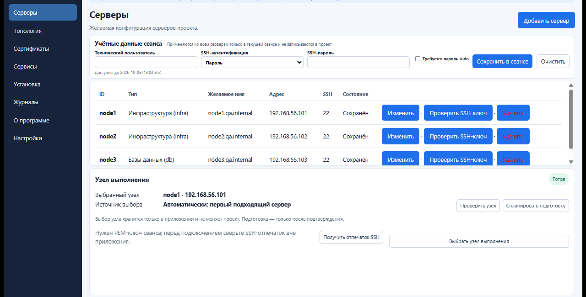
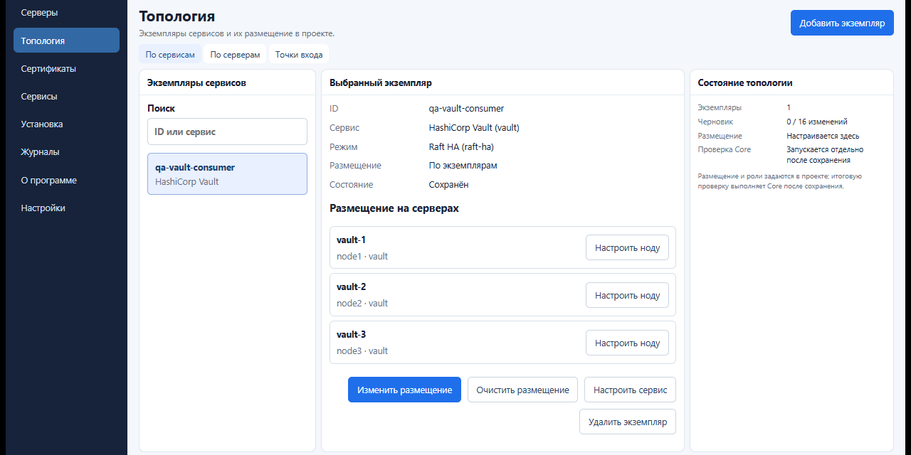
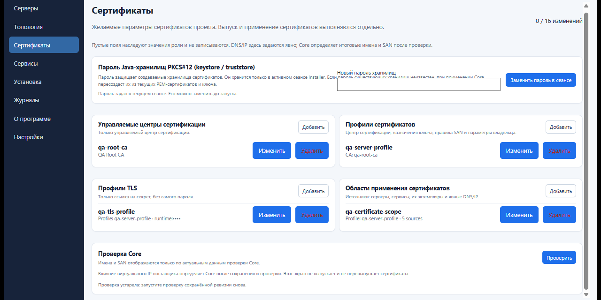
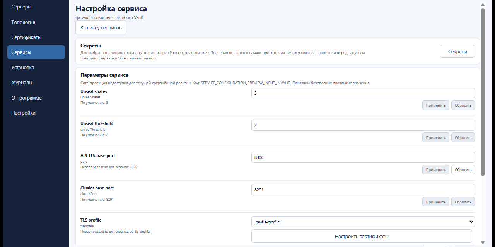
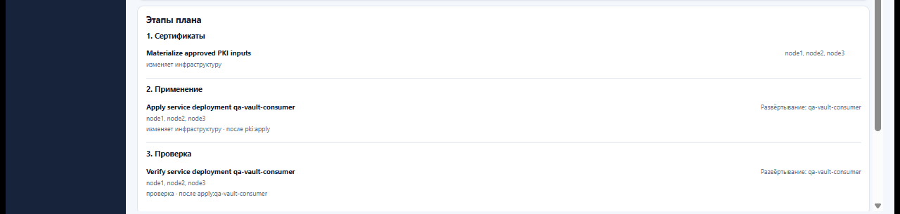
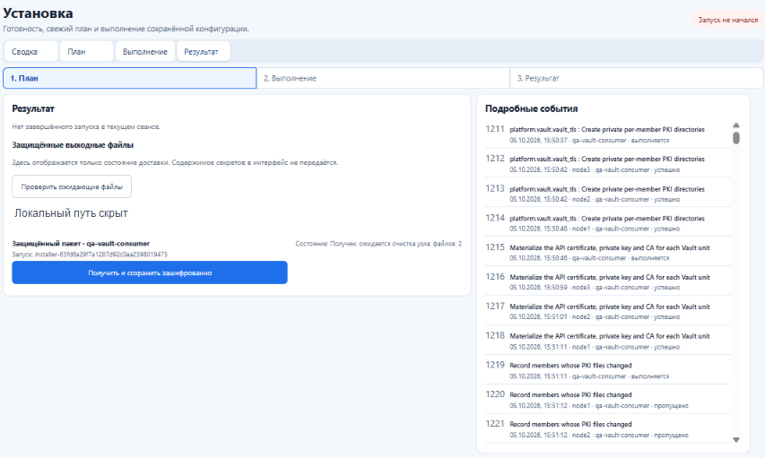
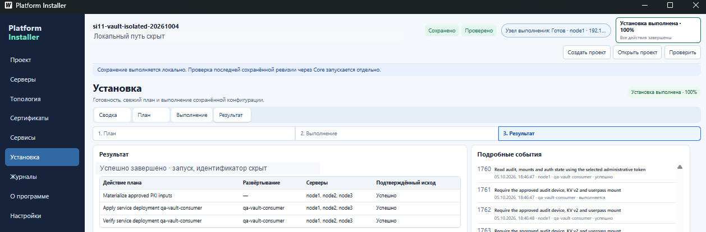

# Platform Installer V2 Руководство администратора

Настоящее руководство устанавливает порядок работы администратора с Platform Installer V2: подготовка переносимого проекта, настройка инфраструктуры, формирование и утверждение плана, выполнение установки и проверка результата. Требования к доступам и поддерживаемым конфигурациям уточняются в документации соответствующих компонентов. Сведения о состоянии реализации и приёмки приведены в [CURRENT_STATE.md](../CURRENT_STATE.md).

## Назначение и архитектура

Platform Installer V2 предназначен для описания и развертывания инфраструктурных служб на серверах Linux. Единственный источник желаемого состояния — переносимый проект Ansible на основе инвентаря, переменных групп и переменных узлов. Интерфейс на React и Wails служит для редактирования проекта и отображения состояния установки. Компонент на Go сохраняет проект и управляет ходом установки. Ansible Core — самостоятельная система автоматизации, которая проверяет проект, рассчитывает план, устанавливает службы и проверяет результат. Она выполняется на выбранном узле выполнения (Execution Node) и обращается к целевым серверам по SSH. Рабочая станция с интерфейсом не выполняет Ansible Core.

```text
Инженер → интерфейс (React/Wails) → Go → узел выполнения (Ansible Core) → целевые серверы
                    ↘ переносимый проект ↗                 ↘ события и итог → интерфейс
```

Для работы с системой используются следующие виды данных:

| Что | Значение |
| --- | --- |
| Желаемое состояние | То, что записано в переносимом проекте: серверы, размещение служб, настройки и намерение использовать точки доступа и сертификаты. |
| Обнаруженные факты | Сведения о доступности, операционной системе и возможностях серверов. Это результат наблюдения, а не часть проекта. |
| План | Действия, рассчитанные Ansible Core для сохранённой редакции проекта, выбранного узла выполнения и среды выполнения. Сам план ничего не устанавливает. |
| Результат | То, что произошло во время запуска: состояния, события задач, проверки и ошибки. Успешное планирование не означает успешное выполнение. |
| Секреты | Пароли, ключи и токены, необходимые только во время работы. Их значения не входят в проект, план или журнал. |

## Порядок работы в интерфейсе

1. **Проект.** Создать или открыть каталог проекта. Проверить путь, совместимость каталога служб и сохранённую редакцию. Импорт и экспорт переносят конфигурацию без временных секретов, обнаруженных фактов и истории запусков.
2. **Серверы.** Указать целевые узлы и параметры соединения. Выбрать и подготовить узел выполнения (Execution Node), затем проверить его готовность. Тип сервера служит описанием и не определяет размещение служб.
3. **Топология.** Добавить экземпляры служб, выбрать режимы и назначить логических участников и роли целевым узлам. На одном сервере могут работать несколько участников. Определить группы точек доступа и их связь со службами.
4. **Сертификаты.** Задать профили TLS, области применения сертификатов и источники имён. Ansible Core формирует запросы и списки дополнительных имён сертификатов (SAN) по топологии. Изменение назначения ранее выпущенного сертификата требует отдельной процедуры перевыпуска.
5. **Службы.** Настроить параметры каждого экземпляра. Доступные режимы, поля и ограничения определяет версионируемый пакет службы. Значения секретов вводятся в интерфейсе только на время сеанса и не записываются в файлы YAML проекта.
6. **Сохранение и проверка.** Команда «Сохранить» (`Save`) записывает желаемое состояние. Она подтверждает корректность записи, но не успешность установки. При необходимости выполняется проверка проекта (`Project Verify`) средствами Ansible Core без обращения к целевым серверам. После изменения проекта результаты проверки прежней редакции устаревают.
7. **Установка → Сводка.** Проверить наличие сохранённой редакции, состояние `READY` выбранного узла выполнения и совместимость среды выполнения. Если условие не выполнено, перейти в указанный интерфейсом раздел.
8. **Установка → План.** Сформировать новый план проекта или выбранного экземпляра службы. Проверить действия, целевые узлы, зависимости, сопутствующие изменения служб-поставщиков, замечания и обязательные подтверждения. Заблокированный или устаревший план нельзя утвердить и запустить. Подтверждение относится только к конкретному плану.
9. **Запуск.** Предоставить необходимые на время сеанса секреты, включая пароль хранилища PKI, если он требуется плану. Перед запуском компонент на Go повторно проверяет редакцию проекта, среду выполнения и план. Узел выполнения создаёт идентификатор запуска `runId`, закрепляет связь запуска с планом и запускает управляющий процесс.
10. **Установка → Выполнение и Результат.** Следить за событиями и итогом конкретного запуска по `runId`. Запрос отмены не означает, что работа остановлена немедленно. Переход на другую страницу, закрытие интерфейса или потеря наблюдателя не отменяют работу на узле выполнения. Проверить конечное состояние запуска и итоги контрольной проверки.

Навигация также содержит «Журналы», «Справка», «О программе» и «Настройки». В журналах отображаются безопасные события; текущий запуск и его итог находятся на странице «Установка». Просмотр результата не запускает повторную проверку.


Рисунок 1. Сводка проекта показывает сохранённые объекты; отсутствие проверки не является подтверждением готовности к запуску.


Рисунок 2. Верхняя панель остаётся на экранах приложения и показывает проект, сохранение, проверку и готовность узла. Локальный путь скрыт.


Рисунок 3. Серверы и узел выполнения. Адреса относятся к изолированной сети испытаний с преобразованием сетевых адресов (NAT).


Рисунок 4. Перед запуском проверяют готовность узла и сохранённую редакцию; наличие плана само по себе установку не запускает.

## Состав и хранение проекта

Оператор задаёт желаемое состояние средствами Ansible. В проекте, которым управляет Installer, его поля записываются в `inventory/group_vars/all/platform-installer.yml` и `inventory/host_vars/<host>/platform-installer.yml`; файл `inventory` перечисляет целевые узлы. В самостоятельном проекте Ansible можно использовать стандартные `inventory/group_vars/all/platform.yml`, `host_vars` и документированные переменные ролей. Файл `project.yml` необязателен и содержит сведения для совместимости; он не заменяет основные файлы проекта. В `ansible.cfg` сохраняется требуемая настройка `hash_behaviour = merge`.

Поля имеют разный смысл: `serviceType` — тип службы в каталоге (например, PostgreSQL); `serviceDeployment` — конкретный экземпляр службы в проекте; `member` — логический участник этого экземпляра; `host` — целевой сервер. Само наличие пакета в каталоге не означает, что служба будет установлена. Ansible Core формирует действия только для экземпляров, объявленных в проекте. Один тип службы может иметь несколько независимых экземпляров, если это допускают пакет и конфигурация проекта.

Результаты обнаружения, вычисленные группы Ansible, переменные среды выполнения, планы, журналы и значения секретов не записываются в переносимое описание желаемого состояния. Машинные идентификаторы и контрольные отпечатки хранятся отдельно как автоматически создаваемые данные; в Installer они принадлежат узлу выполнения и связаны с идентификатором проекта.

## Топология точек доступа и сертификаты

Топология описывает, какой экземпляр службы устанавливается, из каких участников он состоит, на каких серверах размещён и от каких служб зависит. Ansible Core проверяет ссылки, ограничения выбранного режима и обязательные зависимости, затем рассчитывает порядок действий. Интерфейс не вычисляет его по собственным правилам.

Для службы с внешней точкой доступа указывается `endpointGroup`. Группа задаёт домен DNS и намерение использовать подстановочный шаблон домена; Ansible Core вычисляет полное доменное имя (FQDN) из идентификатора экземпляра службы и домена. Виртуальный IP-адрес (VIP) принадлежит сетевой службе-поставщику, например Keepalived; имена DNS и маршрутизацию настраивают соответствующие пакеты. Поэтому адрес является результатом согласования нескольких экземпляров служб, а не произвольным полем одной службы. Kafka использует собственную модель именованных сетевых адресов и точек подключения.

Профили инфраструктуры открытых ключей (PKI) и области сертификатов задают требуемую идентичность. Ansible Core формирует запросы по целевым серверам, участникам, экземплярам служб и точкам доступа, упорядочивает дополнительные имена сертификата (SAN) и передаёт создание сертификатов на узел выполнения. Закрытый ключ, пароль хранилища и другие секреты нельзя записывать в проект или события. Обычная операция применения конфигурации не должна незаметно менять уже установленную идентичность сертификата; для этого предусмотрен отдельный перевыпуск. Поддерживаемость конкретного формата и сценария проверяйте по пакету службы и актуальному состоянию реализации.


Рисунок 5. Экземпляр службы размещается по участникам; итоговые правила проверяет Ansible Core.


Рисунок 6. Экран сертификатов содержит ссылки и параметры профилей; значения паролей на снимке не отображаются.

## Автономный комплект и узел выполнения

Автономный комплект — проверенный неизменяемый набор Ansible Core, пакетов служб, контрактов и необходимых установочных файлов. Локальный кэш публикуется по криптографическому контрольному отпечатку; замена означает выпуск новой версии комплекта. В среде разработки (DEV) можно отдельно собрать и проверить новую версию. В промышленной среде (PROD) установка не загружает недостающие пакеты из интернета и не изменяет комплект.

Сначала для каждого узла проверяется совместимый пакет из назначенного ему одобренного репозитория, затем — совместимый установочный файл из проверенного автономного комплекта. Если подходящего источника нет, планирование или установка блокируется. Наличие файла на рабочей станции не делает его разрешённым источником.

Узел выполнения (Execution Node) — выбранный сервер Linux с подготовленным доступом, проверенной средой выполнения и Ansible Core. Он может одновременно быть целевым сервером либо выделенным узлом. Компонент на Go рабочей станции управляет проектом, передачей данных и обменом сообщениями; узел выполнения хранит достоверный журнал запуска и соединяется с целями по SSH. Доверие SSH к узлу выполнения и к целевым серверам проверяется отдельно. Состояние `READY` необходимо для планирования и запуска, но не заменяет проверки доступа и прав на каждом целевом сервере.


Рисунок 7. Пример страницы настроек Vault. Для этой редакции данные Ansible Core недоступны (`SERVICE_CONFIGURATION_PREVIEW_INPUT_INVALID`); показаны безопасные локальные значения. Снимок не подтверждает корректность конфигурации.

## Планирование, установка и повторный запуск

Каждая установка требует последовательности **сохранённая редакция → новый `BuildDeploymentPlan` → проверка и подтверждение → `StartExecution`**. Команда `Project Verify` помогает диагностировать проект, но не разрешает запуск. Если изменились редакция проекта, среда выполнения или срок действия плана, сформируйте новый план. Выбор одного экземпляра службы может добавить необходимые действия для связанных поставщиков точки доступа; перед подтверждением проверьте полный состав плана.

Узел выполнения хранит журнал. Компонент на Go получает события порциями и передаёт интерфейсу только ограниченные безопасные поля: этап, действие, задачу, целевой сервер, порядковый номер, состояние и замечания. Интерфейс не читает необработанный стандартный вывод Ansible (`stdout`) и не определяет самостоятельно, чем завершилась установка. Если события перестали отображаться, это означает потерю наблюдения; итог сверяют с достоверным состоянием запуска. Успех подтверждается конечным результатом и предусмотренной контрольной проверкой.


Рисунок 8. Пример этапов плана; само наличие плана не означает успешной установки.


Рисунок 9. Журнал этого испытательного запуска завершился состоянием `FAILED`; снимок иллюстрирует диагностику сбоя, а не успешную установку.


Рисунок 10. В этом сеансе экран результата не обнаружил завершённого запуска; при этом отображались подробные события и защищённый пакет, ожидающий очистки. Локальный путь на исходном снимке скрыт.


Рисунок 11. Отдельный снимок того же проекта показывает завершение установки на 100% и успешный результат для всех трёх этапов на node1–node3. Пути и идентификатор запуска скрыты. Этот результат относится к показанному запуску и сам по себе не подтверждает общую приёмку всех служб.

После успешной установки создайте **новый** план для той же сохранённой конфигурации и выполните повторный запуск. Ожидаемое значение `changed=0` означает, что повторное применение не изменило целевые серверы; это подтверждают события и итог именно нового запуска. Это не универсальная гарантия: изменение обнаруженных фактов, установочных файлов, среды выполнения или ручные действия могут привести к другому плану или результату.

## Работа с Ansible без графического интерфейса

Графический интерфейс не обязателен для Ansible Core. Инженер Linux может использовать переносимый проект и совместимый автономный комплект, задать инвентарь и документированные переменные ролей, а затем выполнить стандартные сценарии Ansible командой `ansible-playbook`. Доступные операции Ansible Core: проверка, планирование, применение и контроль результата. Точные сценарии, параметры и требования указаны в [документации Ansible Core](ansible-core.md), [контракте проекта](project-contract.md) и файле README нужного пакета. Самостоятельная работа сохраняет те же правила служб и запрет на запись секретов в проект, но не использует сеансовое управление установкой в интерфейсе.

## Службы, ограничения и состояние реализации

Пакеты в каталоге `services/` задают роли Ansible, режимы, параметры и проверки конкретных служб. В текущем дереве находятся Keepalived, BIND, клиент DNS (DNS client), HAProxy, Kafka, PostgreSQL, Redis, Vault, ClickHouse и Docker в режиме без привилегий root вместе с Compose. Это перечень реализованных пакетов, а не утверждение, что весь набор принят в рамках одного запуска. Режим, целевые операционные системы, ограничения и требования к секретам проверяйте по манифесту и файлу README соответствующего пакета.

Состояние [CURRENT_STATE.md](../CURRENT_STATE.md) содержит актуальные результаты этапов и ограничения. В нём зафиксированы отдельные успешные проверки служб и частичные приёмки. Записи относятся к разным датам и уровням испытаний; при расхождении ориентируйтесь на наиболее свежую запись и журнал соответствующего этапа. Частичные результаты нельзя трактовать как общую приёмку всех служб.

## Глоссарий

| Термин | Определение |
| --- | --- |
| Ansible | Система автоматизации настройки серверов и выполнения типовых операций. В этом продукте выполняет инфраструктурную работу по описанию проекта и правилам служб. |
| Ansible Core | Самостоятельно распространяемый продукт автоматизации Platform Installer V2 на основе Ansible. Это не только одноимённый пакет Python: в состав могут входить коллекция Ansible, роли, стандартные сценарии, средства проверки, схемы и обработчики событий. Ansible Core проверяет проект, рассчитывает топологию и зависимости, строит план, вызывает роли служб, выполняет установку и проверяет результат. Он работает без графического интерфейса и без компонента на Go. |
| Core | Краткое обозначение Ansible Core в тексте руководства. Оно не означает ядро операционной системы или отдельный сервер. |
| Installer | Настольное приложение Platform Installer: интерфейс и компонент на Go для редактирования проекта, сохранения, планирования, подтверждения и наблюдения за установкой. Оно не выполняет Ansible Core локально. |
| Узел выполнения (Execution Node) | Выбранный сервер Linux, на котором выполняются Ansible Core, Ansible и их среда Python. Он получает проект и проверенный комплект, ведёт достоверное состояние запусков и обращается к целевым серверам по SSH. Это не обязательно целевой сервер. |
| Целевой сервер (host) | Сервер, на который Ansible устанавливает или на котором проверяет службу. Его имя в коде контракта — `host`. |
| Экземпляр службы (`serviceDeployment`) | Одна конкретная служба, которую оператор хочет установить: с выбранным режимом, участниками и размещением. Несколько экземпляров одного типа службы могут быть независимы. |
| Участник (member) | Логическая часть экземпляра службы, например узел кластера базы данных. Участника размещают на целевом сервере. |
| Тип службы (`serviceType`) | Возможность из каталога, например PostgreSQL или Vault. Наличие типа в каталоге не означает, что он включён в проект. |
| Топология | Описание экземпляров служб, их участников, размещения по серверам, режимов, зависимостей и точек доступа. |
| Точка доступа (`endpointGroup`) | Предусмотренное проектом имя или адрес, через который клиент обращается к службе. Для её подготовки могут взаимодействовать DNS, виртуальный IP и службы-маршрутизаторы. |
| Поставщик точки доступа | Экземпляр сетевой службы, который предоставляет одну из частей точки доступа, например виртуальный IP-адрес или запись DNS. |
| Автономный комплект (offline bundle) | Проверенный неизменяемый набор Ansible Core, пакетов служб, контрактов и установочных файлов для работы без загрузки из интернета. Новое содержимое публикуется отдельной версией комплекта. |
| Контрольный отпечаток (digest) | Короткое обозначение криптографической контрольной суммы содержимого проекта или комплекта. Позволяет проверить, что данные не изменились; сам по себе не является секретом или доказательством доверенного происхождения. |
| Среда выполнения (runtime) | Проверенный набор программ и параметров, необходимых для выполнения Ansible Core на узле выполнения. Временные рабочие файлы относятся к этой среде, а не к желаемому состоянию проекта. |
| Пакет службы | Версионированный набор описания службы, схемы её параметров, ограничений топологии, ролей Ansible, проверок и объявленных установочных файлов. |
| Роль Ansible | Повторно используемый набор задач, шаблонов и значений по умолчанию для настройки определённой части системы. Роли читают обычные документированные переменные. |
| Инвентарь (`inventory`) | Файл или набор файлов Ansible, в которых перечислены целевые серверы и, при необходимости, группы серверов. Это входные данные проекта, а не найденные автоматически факты. |
| `group_vars` и `host_vars` | Стандартные каталоги Ansible для переменных групп и отдельных серверов. В Platform Installer через них задаётся желаемое состояние. |
| Сценарий Ansible (`playbook`) | Описанная в YAML последовательность задач, которую Ansible запускает для выбранных групп или целевых серверов. Команда запуска сценария — `ansible-playbook`. |
| Манифест | Машиночитаемое описание пакета службы: его идентификатор, версия, режимы, поля и требования. Это описание возможностей пакета, а не само желаемое состояние проекта. |
| Контракт | Версионируемое описание формата запроса, ответа, события или результата между компонентами. Совпадающий термин в интерфейсе не заменяет проверку соответствующей версии контракта. |
| План | Рассчитанный Ansible Core перечень действий для точной редакции проекта и выбранной среды выполнения. План не запускает установку и должен быть явно подтверждён. |
| `BuildDeploymentPlan` | Операция Go и узла выполнения, запрашивающая у Ansible Core новый план для текущей редакции проекта. |
| `StartExecution` | Операция, запускающая ранее проверенный и подтверждённый план. Она не должна подменять его другим планом или изменившейся редакцией проекта. |
| `Project Verify` | Проверка сохранённого проекта средствами Ansible Core без установки на целевые серверы. Она помогает найти проблемы, но не заменяет план и подтверждение запуска. |
| Применение (`apply`) | Операция исполнения плана: Ansible приводит целевые серверы к желаемому состоянию. В команде и интерфейсе может встречаться английское имя `apply`. |
| Контроль результата (`verify`) | Проверка фактически настроенной службы после применения. Успешный план не заменяет такую проверку. |
| Секрет | Пароль, закрытый ключ или токен. Вводится и хранится только в разрешённом временном контексте; не записывается в файлы проекта, события или отчёты. |
| Редакция проекта | Точное сохранённое содержимое проекта, определяемое контрольным отпечатком. Изменение желаемого состояния образует новую редакцию. |
| Идентификатор запуска (`runId`) | Идентификатор конкретной попытки установки, создаваемый узлом выполнения. По нему связываются события и итог. |
| `READY` | Машиночитаемое состояние готовности узла выполнения. Оно не гарантирует, что доступ и необходимые права проверены на каждом целевом сервере. |
| `changed=0` | Признак Ansible, что повторное применение не внесло изменений. Его оценивают по событиям и результату конкретного повторного запуска. |
| PKI | Инфраструктура открытых ключей: профили и процедуры, которыми формируются и используются сертификаты и закрытые ключи. |
| TLS | Протокол защиты соединения шифрованием и проверкой подлинности сторон. |
| SAN | Дополнительные имена сертификата (Subject Alternative Name), по которым клиент проверяет, что сертификат подходит адресу службы. |
| DNS | Система доменных имён, сопоставляющая доменные имена с сетевыми адресами и другими записями. |
| FQDN | Полное доменное имя, однозначное в своей DNS-иерархии, например имя узла или службы вместе со всеми частями домена. |
| VIP | Виртуальный IP-адрес, который предоставляется службой высокой доступности и может перемещаться между серверами. |
| SSH | Защищённый протокол удалённого доступа к Linux-серверам; Platform Installer использует его для соединения узла выполнения с целями. |
| API | Программный интерфейс, по которому компоненты обмениваются запросами и ответами. Имена операций и версий контрактов сохраняются в оригинальном виде. |
| Linux | Семейство операционных систем, на котором выполняются Ansible Core и службы проекта. В статусах конкретной платформы могут быть указаны поддерживаемые дистрибутивы, например RED OS. |
| Интерфейс пользователя (UI) | Экранная часть приложения, предназначенная для просмотра и изменения проекта. В Platform Installer это React-приложение, встроенное в настольную оболочку Wails. |
| YAML | Текстовый формат файлов конфигурации, применяемый в проекте Ansible. Ключи, отступы и имена файлов имеют значение для разбора. |
| DEV и PROD | Сокращения для среды разработки и промышленной среды. В среде разработки разрешены отдельные операции сборки комплекта; в промышленной установке неизменяемый комплект не перестраивают. |
| Кэш | Локальная копия уже проверенного содержимого, используемая повторно без нового получения из источника. |
| Журнал (`log`) | Последовательность безопасных событий, отражающих ход и результат конкретного запуска. Журнал не должен содержать значения секретов. |
| Raft | Протокол согласования, с помощью которого участники кластера Vault поддерживают общее состояние. Режим Raft в Vault предполагает размещение нескольких участников. |
| React, Wails и Go | React отображает интерфейс; Wails связывает его с настольным приложением; Go реализует локальное управление проектом и установкой. Ни один из этих компонентов не заменяет инфраструктурные правила Ansible Core. |

## Нормативные и справочные документы

- [Архитектура](architecture.md) — границы интерфейса, Go, Ansible Core и узла выполнения.
- [Контракт переносимого проекта](project-contract.md) — файлы и разделение желаемого, вычисленного и наблюдаемого.
- [Автономный Ansible Core](ansible-core.md) — работа без графического интерфейса.
- [Архитектура установки UI-02](ui-02-architecture.md) — план, подтверждение, запуск, события и результат интерфейса.
- [Дизайн интерфейса](ui-design-01.md) — назначение экранов; демонстрационные значения макета не являются правилами Ansible Core.
- [Текущее состояние](../CURRENT_STATE.md) — свежие статусы, доказательства и ограничения приёмки.
